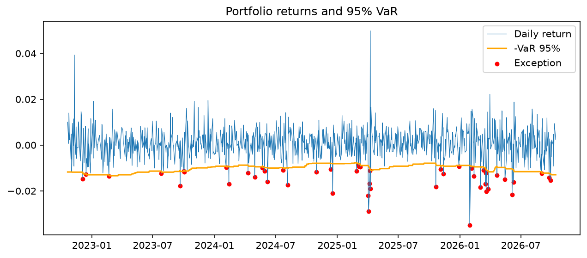

# VaR Backtest

This project estimates the 1-day Value at Risk (VaR) of a portfolio of four funds (US stocks, Canadian stocks, long US government bonds and gold) in two ways, then tests whether the estimate was right on about four years of real daily returns. All results use equal weights.

## The question
How often is the VaR broken, compared with what is expected (5% of days at the 95% level, 1% at the 99% level)? Is there a difference between the historical method and the parametric method?

## The data
- Four funds: SPY (US stocks), XIU.TO (Canadian stocks), TLT (long US government bonds) and GLD (gold).
- Daily prices from Yahoo Finance, downloaded with yfinance and adjusted for dividends and splits, from 2021-10-13 to 2026-10-13. That is 1,228 days of prices and 1,227 daily returns.
- The portfolio holds the four funds in equal weights. Its daily return is the average of the four funds' returns.

## The method
- Historical VaR: I take the daily returns of the last 250 days and find the loss that only 5% (or 1%) of those days were worse than. I show it as a positive number.
- Parametric VaR: I assume the returns follow a normal (bell) curve. I use the average and the standard deviation of the last 250 days: the VaR is 1.645 (95%) or 2.326 (99%) times the standard deviation, minus the average.
- Rolling window: every day gets its own VaR, calculated from the 250 days before it. The day itself is not used, so there is no lookahead bias.
- Backtest: for each test day I compare the real return with that day's VaR. If the loss was bigger than the VaR, the day is an exception. The exception rate is the number of exceptions divided by the number of test days. A good 95% VaR has a rate close to 5%, and a good 99% VaR close to 1%.

## Results
Test period: 977 days, from 2022-10-21 to 2026-10-13. An exception is a day when the loss was bigger than that day's VaR.

- The historical 95% VaR was broken on 48 days (4.9%). About 49 days (5%) were expected.
- The historical 99% VaR was broken on 11 days (1.1%). About 10 days (1%) were expected.
- The parametric 95% VaR was broken on 42 days (4.3%). About 49 days (5%) were expected.
- The parametric 99% VaR was broken on 19 days (1.9%). About 10 days (1%) were expected.

The chart shows the daily portfolio return (blue), minus the historical 95% VaR (orange) and the exceptions (red dots).

## What I found
In my run, the exceptions did not come evenly over the 977 test days. They came in clumps. April 2025 (5 exceptions) and March 2026 (6 exceptions) hold 11 of the 48 exceptions, while 23 of the 49 months had none.

Both clumps coincided with big news. On April 2, 2025 the US announced new tariffs on almost all its trading partners, and on April 3 the S&P 500 fell 4.8% (Investopedia, April 3, 2025). In March 2026 the war in the Middle East escalated and oil prices rose sharply (Embark, Market Recap, March 2026). In my data, US stocks (SPY) fell 4.9% and gold (GLD) fell 11.1% in March 2026, and gold was the biggest loser on all six exception days. The news matches these months, but my data cannot prove that it was the cause.

Sources:
- https://www.investopedia.com/dow-jones-today-04032025-11708250
- https://www.embark.ca/market-recap/market-recap-march-2026

## Checks
- Excel: I rebuilt the historical 95% VaR in Excel from the raw returns. The largest difference from Python over the 977 days was about 1E-16, and Excel counted the same 48 exceptions.

## Limits
- I assume equal weights, reset every day. A real investor may change the weights, and then these numbers would not apply.
- XIU.TO is in Canadian dollars and the other funds are in US dollars. I ignored the exchange rate.
- I dropped 54 days when only one of the two markets was open, so some returns cover two days.
- I used only 5 years of data, and the past does not guarantee the future.
- VaR does not say how big the loss is on the days beyond it.
- At 99% only about 10 exceptions are expected, so one more or less changes the story.

## Mistakes I made
- I typed 2.329 instead of 2.326 for the 99% multiplier. The code did not crash, but the 99% parametric results were slightly wrong. A typo in a number does not cause an error, so I check results against a known value.
- In load_prices I wrote the file name inside the function instead of using the path argument. It worked, but it always read the same file, whatever path I gave it.
- In portfolio_returns I forgot axis=1. mean() then averaged each fund over all the days and gave four numbers instead of one number per day.

## How to run it
Run the four files in this order, from the project folder:

    pip install -r requirements.txt
    python get_data_for_funds.py
    python var_backtest.py
    python make_chart.py
    python exceptions_report.py

Tested with Python 3.14, pandas 3.0.3, yfinance 1.4.1 and matplotlib 3.11.2.
